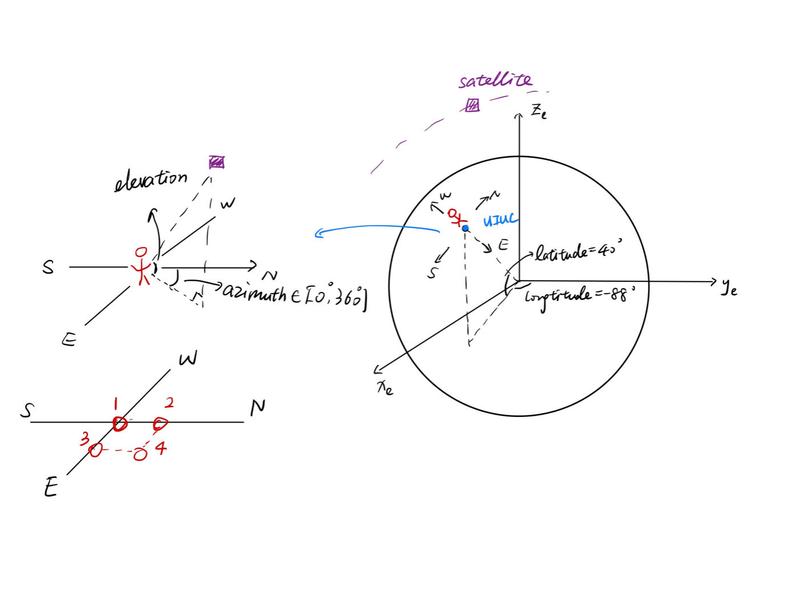
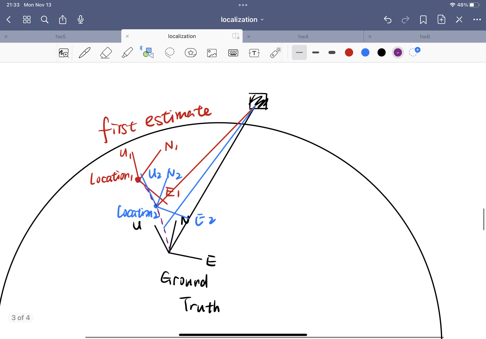

# Potential Localization methods

There are two potential methods for localizing ourselves given the AoA measurements. Method-1 comes out more intuitively, but the equations might be complex to solve. Method-2 can be more efficient, but will need a coarse location as prior knowledge.

## Method-1: Solving 2 nonlinear equations

Look at this figure again. (which is in Earth Centered Earth Fixed (ECEF) coordinate, whose basis are $\hat{\bf x}_e, \hat{\bf y}_e, \hat{\bf z}_e$) Assume our unknown latitude and longitude are $l_a, l_o$, so the UIUC coordinate in ECEF is
$$
{\bf UIUC} = r_E\cos l_a\sin l_o \hat{\bf x}_e + r_E\cos l_a\cos l_o\hat{\bf y}_e+r_E\sin l_a \hat{\bf z}_e.
$$
At the same time, we can get the satellites' coordinate from TLE, which is ${\bf s} = x_s\hat{\bf x}_e+y_s\hat{\bf y}_e+z_s\hat{\bf z}_e)$. Therefore, we can get the vector pointing from UIUC to satellite under the ECEF coordinate:
$$
{\bf s}' ={\bf s-\bf UIUC} =x_s\hat{\bf x}_e+y_s\hat{\bf y}_e+z_s\hat{\bf z}_e-r_E(\cos l_a\sin l_o\hat{\bf x}_e+\cos l_a\cos l_o\hat{\bf y}_e+\sin l_a\hat{\bf z}_e).
$$
**The problem here is that it's expressed in ECEF coordinate, not the same coordinate as our local North East Up (NEU) coordinate**, since for someone who doesn't know it's location, he only knows where is north, east, up, but not ECEF, otherwise he can infer his own location, which is not possible. But we can find the relationship between the two coordinates.

In local coordinate, assume the unit vectors pointing to the North, West and Up are $\hat{\bf x}', \hat{\bf y}', \hat{\bf z}'$, then they can be expressed by the ECEF basis $\hat{\bf x}_e, \hat{\bf y}_e, \hat{\bf z}_e$ according to the latitude and longitude.
$$
\begin{cases}
\hat{\bf z}' = \cos l_a\sin l_o \hat{\bf x}_e + \cos l_a\cos l_o\hat{\bf y}_e+\sin l_a \hat{\bf z}_e,\\
\hat{\bf x}' = -\sin l_a\cos l_o \hat{\bf x}_e + \sin l_a\sin l_o\hat{\bf y}_e+\cos l_a \hat{\bf z}_e,\\
\hat{\bf y}' = \hat{\bf z}'\times \hat{\bf x}', (too\ complicated)
\end{cases}
$$
Now we can express $\bf s'$ under the local coordinate
$$
{\bf s}' = s_x'\hat{\bf x}'+s_y\hat{\bf y}'+s_z\hat{\bf z}',
$$
where coefficients $s_x', s_y', s_z'$ can be expressed by $l_a, l_o$ using the fact that $s_x' = <{\bf s}', \hat{\bf x}'>$, etc. (<> means inner product) Since we measured the azimuth and elevation under the local coordinate, we have two equations to solve:
$$
\begin{cases}
\tan(elevation) = \frac{s_z'}{\sqrt{s_x'^2+s_y'^2}},\\
\tan(azimuth) = \frac{s_y'}{s_x'}.
\end{cases}
$$
which theoretically will give us unknown latitude and longitude $l_a, l_o$.

## Method-2: An iterative approach

I don't know how to solve the equation in method 1, and found a reference using an iterative approach [Angle of arrival geolocation using non-linear optimization | IEEE Conference Publication | IEEE Xplore](https://ieeexplore.ieee.org/document/6479596).

As mentioned in method-1, the difficulty lies in the fact that if we don't know our location, then we don't know the direction of our local coordinate in ECEF. But if we know our coarse location, we can assume we are at some location and get the direction of our local coordinate. We can use this first, getting a result of location using the AoA information, which will be a better estimation of our location (hopefully). Then we update our local coordinate using the new estimation's coordinate and get a better better estimation until it converges to a fixed point. A figure helps to illustrate the idea.

