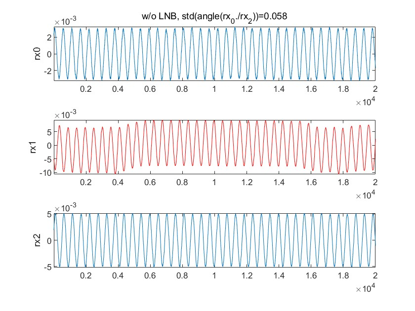
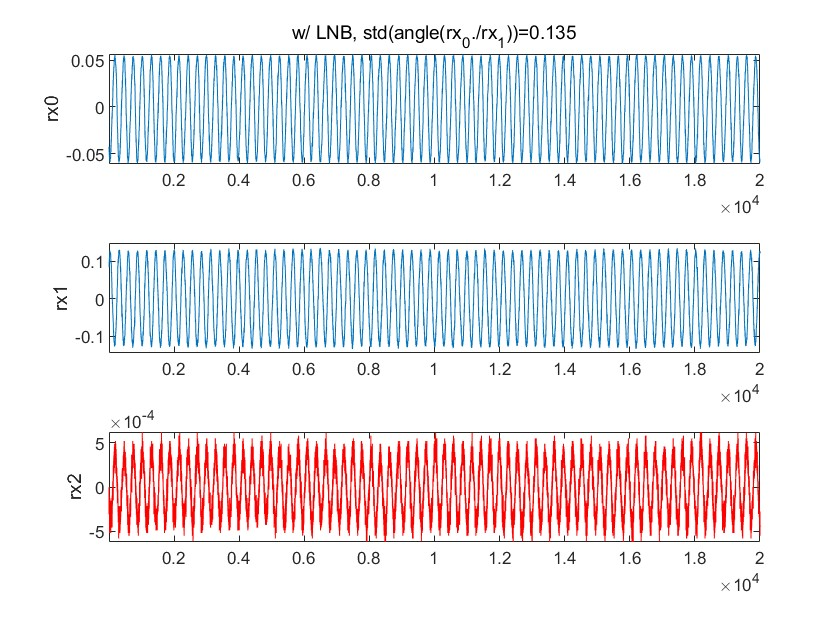
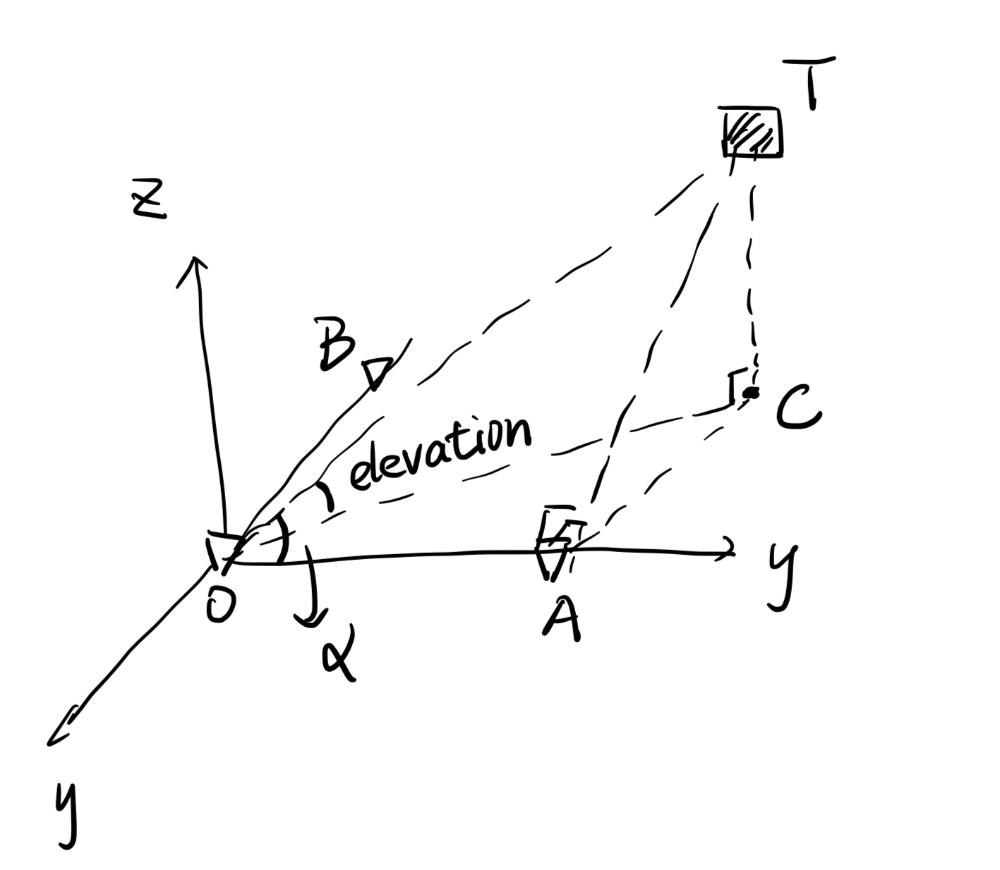
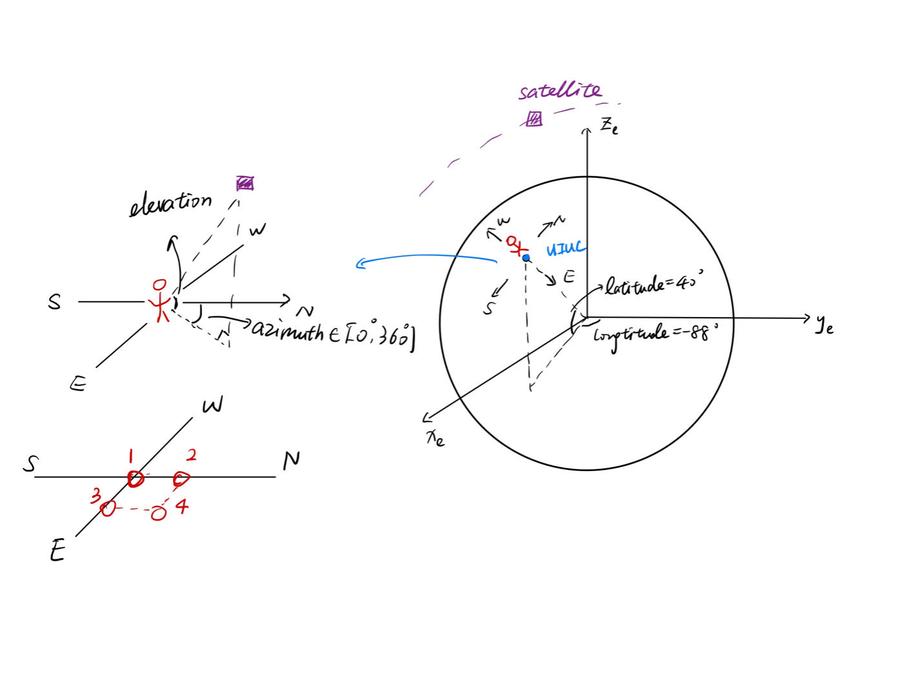
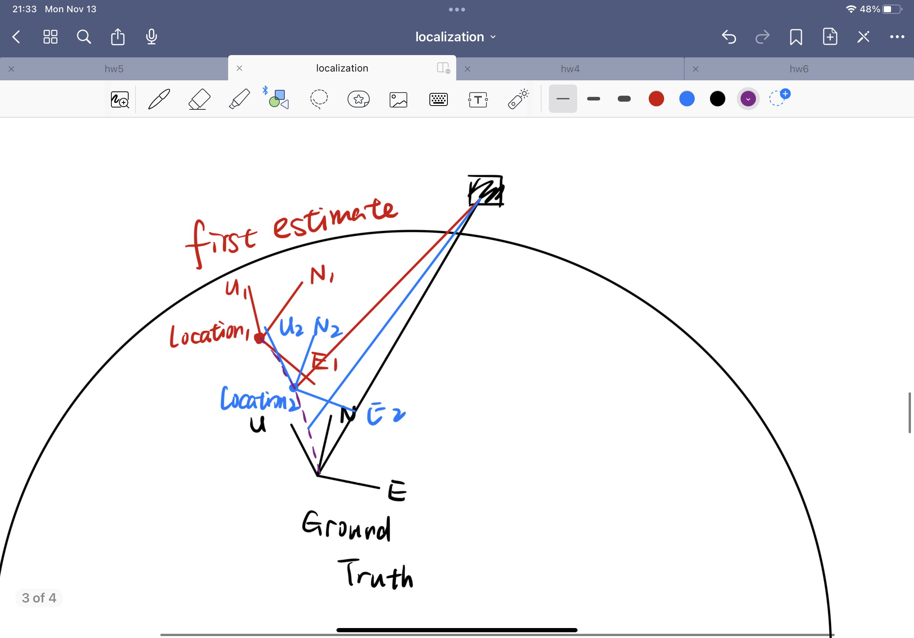

## Error Analysis

**AoA error comes from two parts: Phase noise & antenna spacing, and they are multiplicative.**

**Localization error comes from two parts: AoA error and TLE error (unknown yet).**

- AoA error caused by phase noise

  So far we have two groups of data: one w/o LNB and one w/ LNB.

  - w/o LNB:

    

    the standard variance (std var) of $\delta \phi$ between rx0 & rx2 is 0.058.

  - w/ LNB

    

    the std var of $\delta \phi$ between rx0 & rx2 is 0.135.

  **w/ LNB the phase noise will double**. Averaging can decrease variance of $\delta \phi$ (TODO).

  Next, estimate how much AoA error can phase noise cause.

  Consider 1-d AoA with antenna spacing $d$, the range difference $\delta r = -(\lambda/2\pi)\delta \phi = d\sin\theta$, so
  $$
  \theta = -\arcsin(\frac{1}{2\pi} \frac{\lambda}{d} \delta \phi).
  $$
  Taking the derivative gives the relationship between AoA error $d\theta$ and phase noise $d\delta \phi$:
  $$
  d\theta = -\arcsin'(y)|_{y=\frac{1}{2\pi} \frac{\lambda}{d} \delta \phi}\times\frac{1}{2\pi} \frac{\lambda}{d} d\delta \phi,
  $$
  since $\theta = -\arcsin(y)\Rightarrow y = -\sin \theta$, so
  $$
  \arcsin'(y)|_{y=\frac{1}{2\pi} \frac{\lambda}{d} \delta \phi} = \frac{1}{\sqrt{1-y^2}}|_{y=-\sin \theta} = \frac{1}{|\cos \theta|}.
  $$
  Here we take antenna spacing $d = 5\lambda$ (which is huge: Weapon to increase AoA acc) and refer to the fact that the incident signal cannot be very slanting, suppose $\theta\in[-60^\circ,60^\circ]$, so $\cos\theta > \frac{1}{2}$, thus $|\arcsin'|\leq 2 <\pi$. In this way, a coarse estimation is $d\theta \approx -\frac{1}{10}d\delta \phi$. **So the AoA error is proportional to phase noise,  in the case w/ LNB it's 0.1 times of phase noise.** 

  For case w/ LNB, std var of $\theta\approx 0.0135 \approx 0.8^\circ$. This can be further improved by increasing antenna spacing, but the tradeoff is more ambiguity.

  - **why the incident signal cannot be very slanting**, $\theta\in[-60^\circ,60^\circ]$

    There is a minimum elevation constraint.

    

    O, A, B are antennas and T is the satellite. C is the projection point of T on x-O-y plane, and $\ang COT$ is elevation. So for any line in x-O-y plane, its angle with OT is greater than elevation. Our antennas all lie in x-O-y plane, so for instance, $\alpha = \ang TOA > elevation$, so the AoA of the antenna pair O & A $\theta =90^\circ-\alpha < 90^\circ -elevation \leq 90^\circ -elevation_{min}$. Elevation cannot be too small otherwise the satellite is not observable, assuming $elevation_{min}=30^\circ$ makes sure that $\theta<60^\circ$.

- AoA error caused by antenna spacing $d$

  Here we suppose the ground truth antenna spacing is $d$, however, we think it's $d+\Delta d$. Again take the derivative w.r.t. $d$ and we see the amount of error resulted in AoA:
  $$
  d\theta = \arcsin' \times \frac{\lambda \delta \phi}{2\pi d}\times \frac{\Delta d}{d}\approx
  \frac{\lambda \delta \phi}{2d}\times \frac{\Delta d}{d}.
  $$
  Since the range difference $|(\lambda/2\pi)\delta \phi| = |d\sin\theta|\leq d$, $|\frac{\lambda \delta \phi}{2d}|\leq \pi$, **so the AoA error is the same order as antenna spacing error.** This error is biased. If we think the antenna spacing is 1% more than the ground truth, then the AoA is always 1% larger.

- Loc error caused by AoA error

  If AoA error $d\theta = 0.1^\circ$, then the loc error $dx = rd\theta,$ where $r$ is range of satellite, $\approx 5.5\times 10^5m$. So
  $$
  dx\approx 1km.
  $$

- Loc error caused by TLE error (TODO)

## Potential Localization methods

There are two potential methods for localizing ourselves given the AoA measurements. Method-1 comes out more intuitively, but the equations might be complex to solve. Method-2 can be more efficient, but will need a coarse location as prior knowledge.

- Method-1: Solving 2 nonlinear equations

  

  Look at this figure again. (which is in Earth Centered Earth Fixed (ECEF) coordinate, whose basis are $\hat{\bf x}_e, \hat{\bf y}_e, \hat{\bf z}_e$) Assume our unknown latitude and longitude are $l_a, l_o$, so the UIUC coordinate in ECEF is
  $$
  {\bf UIUC} = r_E\cos l_a\sin l_o \hat{\bf x}_e + r_E\cos l_a\cos l_o\hat{\bf y}_e+r_E\sin l_a \hat{\bf z}_e.
  $$
  At the same time, we can get the satellites' coordinate from TLE, which is ${\bf s} = x_s\hat{\bf x}_e+y_s\hat{\bf y}_e+z_s\hat{\bf z}_e)$. Therefore, we can get the vector pointing from UIUC to satellite under the ECEF coordinate:
  $$
  {\bf s}' ={\bf s-\bf UIUC} =x_s\hat{\bf x}_e+y_s\hat{\bf y}_e+z_s\hat{\bf z}_e-r_E(\cos l_a\sin l_o\hat{\bf x}_e+\cos l_a\cos l_o\hat{\bf y}_e+\sin l_a\hat{\bf z}_e).
  $$
  **The problem here is that it's expressed in ECEF coordinate, not the same coordinate as our local North East Up (NEU) coordinate**, since for someone who doesn't know it's location, he only knows where is north, east, up, but not ECEF, otherwise he can infer his own location, which is not possible. But we can find the relationship between the two coordinates.

  In local coordinate, assume the unit vectors pointing to the North, West and Up are $\hat{\bf x}', \hat{\bf y}', \hat{\bf z}'$, then they can be expressed by the ECEF basis $\hat{\bf x}_e, \hat{\bf y}_e, \hat{\bf z}_e$ according to the latitude and longitude.
  $$
  \begin{cases}
  \hat{\bf z}' = \cos l_a\sin l_o \hat{\bf x}_e + \cos l_a\cos l_o\hat{\bf y}_e+\sin l_a \hat{\bf z}_e,\\
  \hat{\bf x}' = -\sin l_a\cos l_o \hat{\bf x}_e + \sin l_a\sin l_o\hat{\bf y}_e+\cos l_a \hat{\bf z}_e,\\
  \hat{\bf y}' = \hat{\bf z}'\times \hat{\bf x}', (too\ complicated)
  \end{cases}
  $$
  Now we can express $\bf s'$ under the local coordinate
  $$
  {\bf s}' = s_x'\hat{\bf x}'+s_y\hat{\bf y}'+s_z\hat{\bf z}',
  $$
  where coefficients $s_x', s_y', s_z'$ can be expressed by $l_a, l_o$ using the fact that $s_x' = <{\bf s}', \hat{\bf x}'>$, etc. (<> means inner product) Since we measured the azimuth and elevation under the local coordinate, we have two equations to solve:
  $$
  \begin{cases}
  \tan(elevation) = \frac{s_z'}{\sqrt{s_x'^2+s_y'^2}},\\
  \tan(azimuth) = \frac{s_y'}{s_x'}.
  \end{cases}
  $$
  which theoretically will give us unknown latitude and longitude $l_a, l_o$.

- Method-2: An iterative approach

  I don't know how to solve the equation in method 1, and found a reference using an iterative approach [Angle of arrival geolocation using non-linear optimization | IEEE Conference Publication | IEEE Xplore](https://ieeexplore.ieee.org/document/6479596).

  As mentioned in method-1, the difficulty lies in the fact that if we don't know our location, then we don't know the direction of our local coordinate in ECEF. But if we know our coarse location, we can assume we are at some location and get the direction of our local coordinate. We can use this first, getting a result of location using the AoA information, which will be a better estimation of our location (hopefully). Then we update our local coordinate using the new estimation's coordinate and get a better better estimation until it converges to a fixed point. A figure helps to illustrate the idea.

  